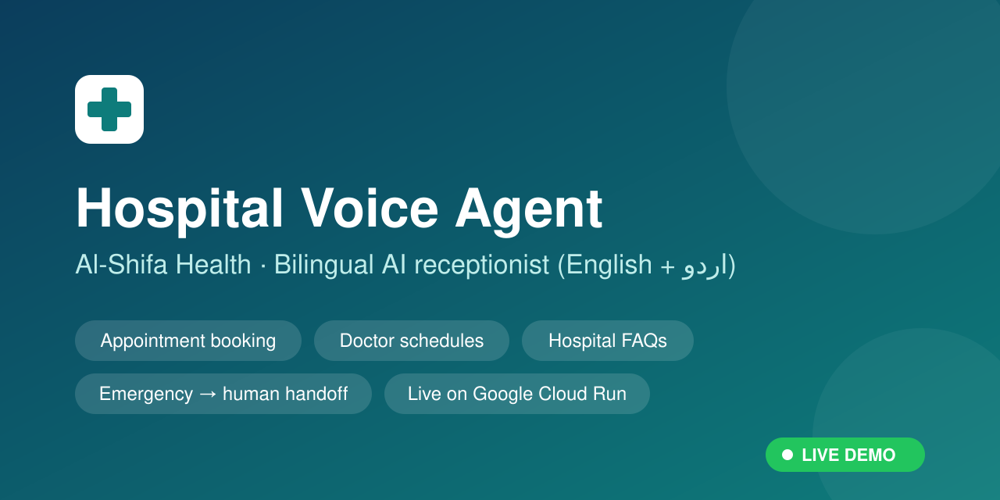

<div align="center">



# Hospital Voice Agent — Al-Shifa Health

**A bilingual AI voice receptionist for hospital questions and appointment support in English and Urdu.**

[](https://alshifahospital-912899628935.asia-southeast1.run.app)
[](https://alshifahospital-912899628935.asia-southeast1.run.app)
[](#features)

### [Try the live demo](https://alshifahospital-912899628935.asia-southeast1.run.app)

</div>

---

## Overview

Hospital Voice Agent is a voice-first assistant that helps patients get routine hospital information and appointment support. It is designed to communicate in English and Urdu, with urgent situations directed to human staff.

## Features

- **Bilingual conversations:** English and Urdu support.
- **Appointment assistance:** Helps patients with appointment booking.
- **Doctor schedules:** Shares doctor availability and schedule information.
- **Hospital FAQs:** Answers common questions about services and operations.
- **Urgent-case escalation:** Directs emergencies to a human instead of attempting a diagnosis.
- **Live demo:** Try the deployed application at [alshifahospital-912899628935.asia-southeast1.run.app](https://alshifahospital-912899628935.asia-southeast1.run.app).

## Demo

Open the [live Al-Shifa Health demo](https://alshifahospital-912899628935.asia-southeast1.run.app).

## Repository contents

This repository currently contains the public project showcase, branding assets, license, and a safe environment-variable template. The running application is hosted separately; application source and deployment files are not included here.

```text
.
├── assets/
│   ├── banner.png
│   └── banner.svg
├── .env.example
├── .gitignore
├── LICENSE
└── README.md
```

Because application source and runtime configuration are not included, this repository does not currently provide a local run or deployment command. Use the live demo to try the application.

## Configuration and secrets

`.env.example` contains placeholder values to document configuration names. It is not a secret file and does not contain working credentials.

If you have the application source in a separate checkout, create your own local `.env` from the template and add your credentials there. **Never commit `.env` files, API keys, service-account files, or other credentials.** The `.gitignore` excludes environment files by default.

## Safety and privacy

- The assistant is for routine information and appointment support, not medical diagnosis.
- Urgent situations should be handled by hospital staff.
- Do not enter real patient information or credentials into public demo or repository content.

## License

See [LICENSE](LICENSE).

---

<div align="center">

Built for more accessible hospital communication in English and Urdu.

</div>
